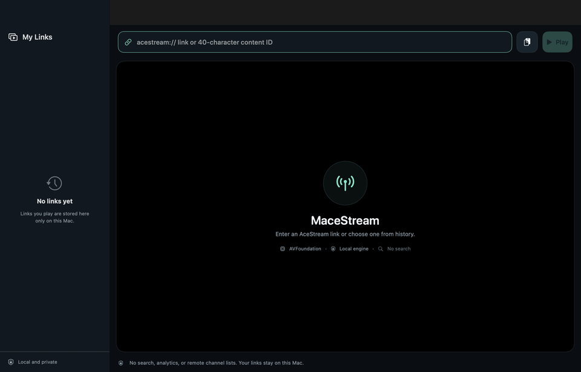
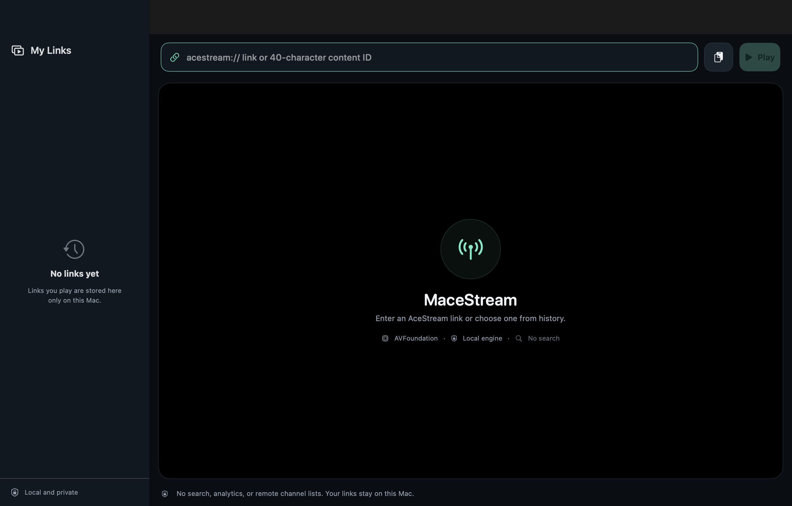
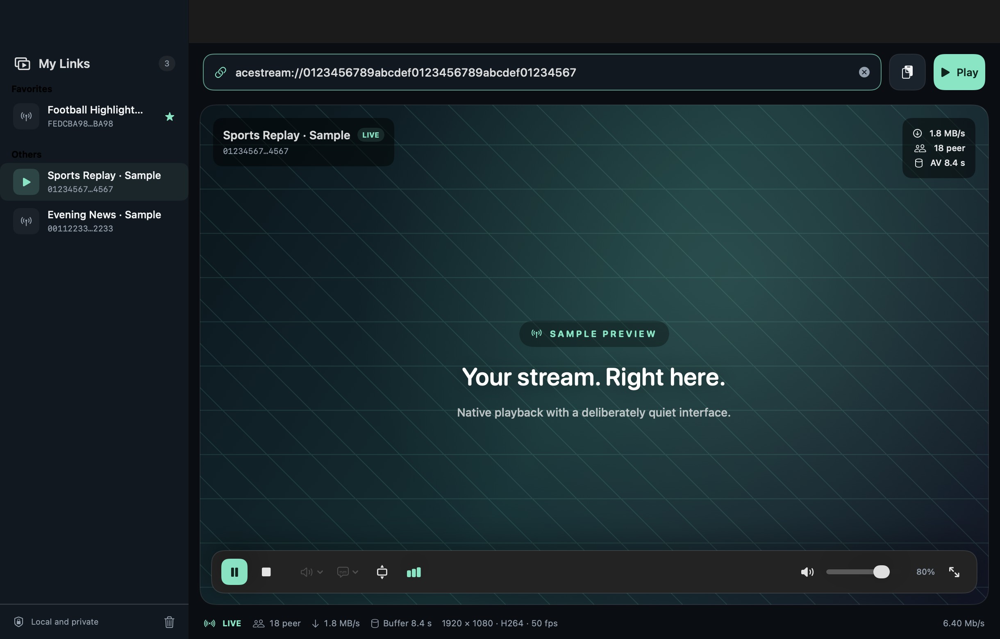
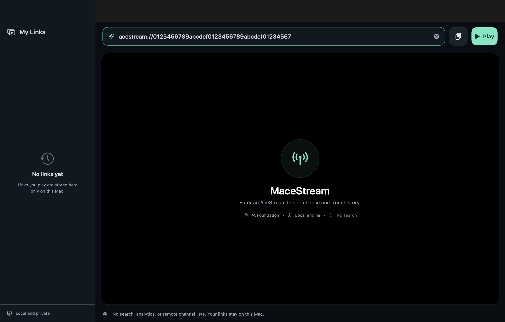
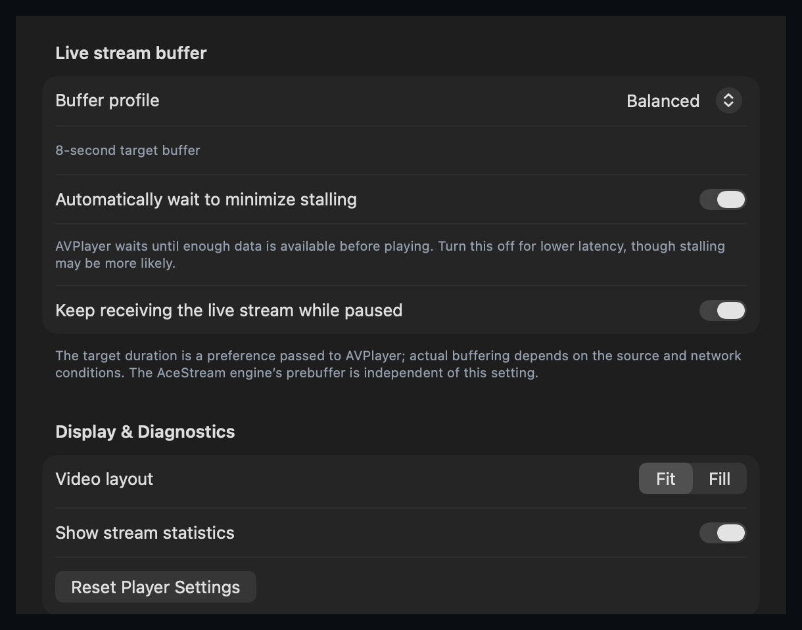

<p align="center">
  
</p>

<h1 align="center">MaceStream</h1>

<p align="center">
  <strong>Your links. Your player. Nothing else.</strong>
</p>

<p align="center">
  A focused, native macOS AceStream player built with Swift and AVFoundation.
</p>

<p align="center">
  <a href="https://github.com/envermeister/MaceStream/actions/workflows/ci.yml"></a>
  
  
  
  
  <a href="LICENSE"></a>
</p>

---

MaceStream plays the AceStream links **you** provide — without turning into a channel catalog, a search service, or a background data-collection machine. No Flutter, no Electron, no VLC installation, no external AceStream setup, and no Docker required for everyday use.

## Walkthrough

<p align="center">
  
</p>

<p align="center">
  <sub>Captured from the native app with clearly marked sample data. No real channel or account is shown.</sub>
</p>

## Screenshots

<p align="center">
  
</p>

<p align="center">
  
</p>

<details>
  <summary>More screenshots</summary>
  <p align="center"></p>
  <p align="center"></p>
</details>

## Why MaceStream?

### Native by design

The interface is SwiftUI and AppKit. Video is rendered through `AVPlayerLayer`, with AVFoundation handling hardware-accelerated decoding when macOS supports the source codec. The Mac app has **no third-party Swift package dependencies**.

### An engine that stays out of the way

A minimal Linux guest runs the official AceStream engine through vfkit. Apple Silicon and Intel receive separate, correctly matched guest kernels in one universal package. The app selects the right guest automatically and shuts down only the VM it owns.

API and playback traffic uses **virtio-vsock**, not fragile host-to-guest IP routing. NAT remains available for the engine's outbound peer-to-peer traffic. Your Mac never has to surrender a fixed port or tolerate another process being killed.

### Buffer controls without the marketing fiction

Choose Automatic, Low Latency, Balanced, High Stability, or a custom target. See engine prebuffering and AVPlayer buffering independently. The selected duration is an AVPlayer preference, not a promise that every live source can honor it.

### Built for live playback

- Play, pause, stop, volume and mute controls.
- Audio track and subtitle selection when supplied by the stream.
- Fit/fill aspect modes and auto-hiding fullscreen controls.
- Peer count, transfer speed, codec, resolution, frame rate and buffer telemetry.
- Stall detection with one pending reconnect task and a bounded retry budget.
- Retry budget recovery after sustained, stable playback.

### Local history, on your terms

Replay a link, rename it, or pin it as a favorite. Up to 60 entries stay in the app's local Application Support directory. There is no remote history sync and no content discovery module.

## Architecture

```text
acestream:// link
        │
        ▼
  SwiftUI / AppKit
        │
        ▼
  PlaybackController ─────── AVPlayer / AVPlayerLayer
        │
        ▼
  127.0.0.1:<ephemeral>
        │
        ▼
  Network.framework TCP relay
        │
        ▼
  vfkit Unix socket + virtio-vsock
        │
        ▼
  Linux guest localhost:6878
        │
        ▼
  Official AceStream engine ───── NAT ───── P2P network
```

The Linux guest and its helper proxy are engine infrastructure. The native macOS application itself is Swift and Apple frameworks only.

## Requirements

- **macOS 13 Ventura or later**
- Apple Silicon or Intel Mac
- Rosetta on Apple Silicon for the official x86_64 AceStream engine

AceStream sources vary. A stream using a codec or container unsupported by AVFoundation may fail even when the engine is healthy. MaceStream deliberately uses **AVFoundation only**, not libmpv or VLCKit.

## Install

Download the universal DMG from [Releases](https://github.com/envermeister/MaceStream/releases), open it, and move **MaceStream.app** to Applications. Distribution builds are signed with Developer ID and submitted for Apple notarization.

No Docker, Homebrew, Python, VLC, or separate AceStream installation is needed on the user's Mac.

## Build from source

```bash
git clone https://github.com/envermeister/MaceStream.git
cd MaceStream
open MaceStream.xcodeproj
```

Generated engine binaries are intentionally excluded from Git. To regenerate both guest architectures on a development machine:

```bash
./scripts/build_macos_engine_image.sh
MACESTREAM_ENGINE_ARCH=x86_64 ./scripts/build_macos_engine_image.sh
```

Docker is needed **only for this development-time artifact generation**. Packaging, Developer ID signing, notarization, CI secrets and engine prereleases are covered in [README_BUILD.md](README_BUILD.md).

Run the tests:

```bash
xcodebuild -project MaceStream.xcodeproj \
  -scheme MaceStream \
  -destination 'platform=macOS' \
  -derivedDataPath .build/DerivedData \
  CODE_SIGNING_ALLOWED=YES \
  CODE_SIGN_IDENTITY=- \
  test
```

Regenerate the README screenshots and walkthrough GIF on macOS with Xcode and ffmpeg installed:

```bash
./scripts/capture_walkthrough.sh
```

Capture mode uses isolated sample data and does not read or modify your real history. It is compiled only into Debug builds.

## Privacy and responsibility

MaceStream includes no analytics, advertising, accounts, remote channel lists, or search service. AceStream is peer-to-peer: peers and your network provider can see network activity and your IP address. Only access content you have the right to use.

Read [PRIVACY.md](PRIVACY.md) and [THIRD_PARTY_NOTICES.md](THIRD_PARTY_NOTICES.md) before distributing a package. Engine binaries retain their separate licenses and redistribution terms.

## License

MaceStream's own source code is available under the [MIT License](LICENSE). Third-party components remain under their respective licenses.
